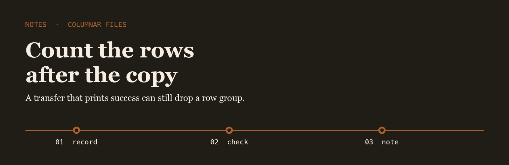
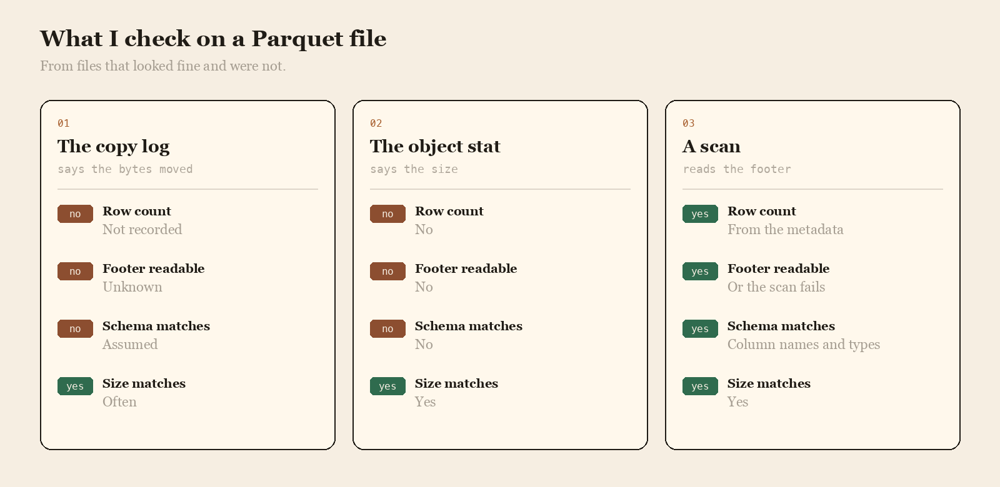

<p align="center">
  
</p>

# Cole Brennan

I spend most days on Parquet, Arrow, and the small disagreements between a file's footer and the rows you can actually scan.

## The question

After a copy, did you count the rows in the new file, or trust the tool that moved it?

<p align="center">
  
</p>

|  | The copy log | The object stat | A scan |
| --- | --- | --- | --- |
| Row count | Not recorded | No | From the metadata |
| Footer readable | Unknown | No | Or the scan fails |
| Schema matches | Assumed | No | Column names and types |
| Size matches | Often | Yes | Yes |

## The line I keep

The line I write after a file lands.

```text
2026-05-18  orders-2026-05.parquet  rows  18442201  cols  36  footer ok  copied from the nightly export
```

Moving the object is solved. Knowing the footer still describes the rows is not.

- [arrow](https://github.com/apache/arrow) is the memory format I check the file against
- [duckdb](https://github.com/duckdb/duckdb) is how I count the rows without standing up a cluster
- [datafusion](https://github.com/apache/datafusion) is the query engine I read when a scan and a footer disagree

I keep a fork of each on this account.

## What I pay attention to

- Row counts from the footer
- Schemas that name their units
- Copies verified by a scan
- Files small enough to open on a laptop

## Working with me

Send a short problem statement, a way to see it happen, and what done looks like. I am independent, remote, and usually around during the Chicago afternoon.
